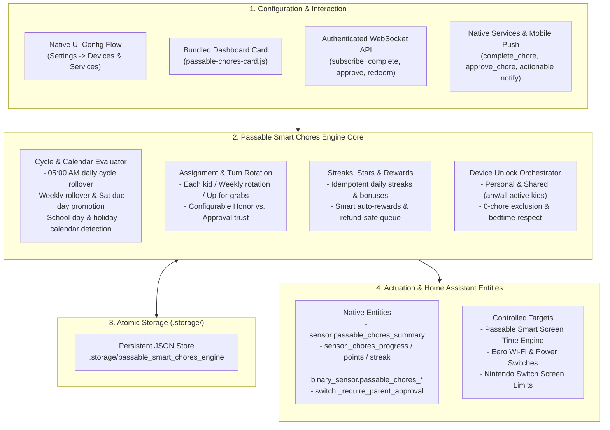

# 🧹 Passable Smart Chores Engine

[](https://github.com/hacs/default)
[](https://github.com/GBear09/passable-smart-chores-engine/releases)
[](LICENSE)

An intelligent, family-friendly chores, streaks, rewards, and screen-time unlock engine for Home Assistant. Part of the **Passable** home automation suite alongside [`passable-smart-light-engine`](https://github.com/GBear09/passable-smart-light-engine), [`passable-smart-climate-engine`](https://github.com/GBear09/passable-smart-climate-engine), [`passable-smart-lock-engine`](https://github.com/GBear09/passable-smart-lock-engine), and [`passable-smart-screen-time-engine`](https://github.com/GBear09/passable-smart-screen-time-engine).

Runs natively on Home Assistant Core's asynchronous engine with atomic `.storage` persistence, zero helper entity clutter, flexible daily/school-day/weekend/weekly schedules, weekly sibling rotation, configurable Honor System vs. Parent Approval trust modes, and a bundled Lovelace dashboard card aligned with the Passable design system.

---

## ⚙️ Key Features

- **🎨 Kid-Friendly Wall-Panel Board & 4 Passable Layouts**:
  - Default **Kid Columns Board (`board`)** displays each child side-by-side in their own accent color with large emoji/picture tiles for younger readers, live streak & star pills, and a lightweight pure-CSS celebration burst at 100%.
  - Also supports Passable Suite **Compact Tiles (`tiles`)**, **Stacked Rows (`rows`)**, and **Circular Progress Rings (`rings`)** with an inline quick-drawer.
  - Automatically hides disabled children or children with `0` active chores today (`hide_inactive_kids: true`).
- **🏆 Two-Tier Hybrid Gamification (All Toggleable)**:
  - **Tier 1 — Required Chores = Baseline Device Unlock + Daily Streak (`🔥`)**: Finishing 100% of required chores unlocks linked screens and increments the child's streak. Days with `0` required chores safely preserve streaks.
  - **Tier 2 — Bonus Bounties & Star Bank (`⭐`) + Rewards Shop**: Post optional *Up-for-Grabs* bonus chores and redeem stars for **Smart Home Auto-Rewards** (`+20m` Screen Time timer, `+15m` daily limit, Nintendo Switch minutes, or any HA service) or **Parent-Fulfilled Rewards** (with mobile push approval & full refund on deny).
  - Flip `gamification_enabled: false` anytime for a clean pass/fail checklist with zero stars or rewards.
- **🛡️ Configurable Trust Mode (Honor System ↔ Parent Approval)**:
  - Configurable **globally**, **per-child** (including a native HA `switch.<kid>_require_parent_approval`), or **per-chore**.
  - **Honor System**: Tap tile → `Done` immediately (with a configurable `15s` tap-again undo window).
  - **Parent Approval**: Tap tile → `Waiting ⏳` → sends actionable push notifications (`Approve` / `Try Again`) to parent phones and lets parents approve on the card or behind an optional **4–6 digit Parental PIN**.
- **📅 Smart Scheduling & Sibling Turn-Taking**:
  - **Daily Reset (`05:00` AM default)**: Prevents late-night chores or early-bird wakeups from crossing days unexpectedly.
  - **School-Day Calendar Awareness**: Checks optional `calendar.*` entities (e.g., `calendar.academic`, `calendar.holidays_in_united_states`) plus a 1-tap **"Treat Today as No-School"** toggle to automatically pause `school_days` chores and activate `weekends` chores on breaks/holidays.
  - **Flexible Weekly Chores**: Visible all week with a `Due Sat` pill so kids can knock them out early without blocking Mon–Fri screen time; automatically promote to **Required Today** on the due day (`Saturday` default) until Monday rollover.
  - **Weekly Turn-Taking (`rotate_weekly`)**: Automatically shifts shared chores (e.g., *Feed Pet*) to the next active child every week on `weekly_reset_day`.
- **📺 Edge-Case-Proof Personal & Shared Screen Unlocks**:
  - Integrates directly with **`Passable Smart Screen Time Engine`** (`set_lockout` / `start_timer`), lockout switches (Eero Wi-Fi pause), power switches, and Nintendo Switch `number.*` limits.
  - Supports **Personal Rules** (per-kid tablet) and **Shared Rules** (`any_active_kid` or `all_active_kids` for shared TVs/consoles).
  - **0-Chore Safeguard**: Automatically ignores children with `0` required chores today so a toddler with no chores never unlocks a shared TV early.
  - **Respects Bedtime Schedules**: Defers chore-based unlocks while Screen Time Engine is holding a device in scheduled downtime or household restriction, and uses a daily unlock latch (`unlocked_for_cycle_date`) so manual parent lockouts later in the day aren't overridden.

---

## 📂 System Architecture



---

## 📦 Installation

### Option 1: Via HACS (Recommended)

1. Open **HACS** in your Home Assistant instance.
2. Click the three dots `⋮` in the top right corner and select **Custom repositories**.
3. Paste the repository URL:
   ```text
   https://github.com/GBear09/passable-smart-chores-engine
   ```
4. Set the Category to **Integration** and click **Add**.
5. Locate **Passable Smart Chores Engine**, click **Download**, and restart Home Assistant.

---

## 🚀 Setup & Onboarding

1. In Home Assistant, go to **Settings → Devices & Services → Add Integration** and search for **Passable Smart Chores Engine**.
2. Choose your default daily reset time (`05:00`), weekly reset/due days (`Monday` / `Saturday`), default trust mode (`Honor System` or `Parent Approval`), and optional school holiday calendars.
3. Add the **Passable Chores Card** (`custom:passable-chores-card`) to your dashboard—no manual Lovelace resource registration required!
4. Open **Command Center → Kids & Trust** directly on the card to add your kids, starter chores, rewards, and Screen Time unlock rules.

---

## 🎛️ Dashboard Card Usage

The card is automatically registered at `/passable_chores_frontend/passable-chores-card.js` upon integration setup.

### Basic Card Configuration

```yaml
type: custom:passable-chores-card
title: Family Chores
display_mode: summary   # 'summary' or 'full'
layout: board           # 'board', 'tiles', 'rows', or 'rings'
tile_size: large        # 'large' (emoji/picture tiles) or 'compact'
show_header: false
show_summary_strip: true
show_footer_strip: true
hide_inactive_kids: true
require_pin: auto       # 'auto', true, or false
admin_visibility: everyone  # 'everyone', 'admins_only', 'selected_users', or 'hidden'
# admin_users:          # Required when admin_visibility is 'selected_users'
#   - <ha_user_id>
```

### Wall Panel Placement Example (Below Family Calendar)

```yaml
type: vertical-stack
cards:
  - type: custom:calendar-card-pro
    # ...your existing calendar config...
  - type: custom:passable-chores-card
    layout: board
    tile_size: large
    show_header: false
    hide_inactive_kids: true
    require_pin: auto
```

### Card Configuration Options

| Option | Default | Description |
| :--- | :--- | :--- |
| `display_mode` | `"summary"` | `"summary"` renders the card + popup Command Center; `"full"` embeds the 4-tab Command Center directly. |
| `layout` | `"board"` | `"board"` (kid columns + inline tiles), `"tiles"` (2-col kid summary), `"rows"` (stacked kids), or `"rings"` (progress rings). |
| `tile_size` | `"large"` | `"large"` for big kid-friendly emoji/picture tiles; `"compact"` for tighter rows. |
| `show_header` | `false` (`true` in `full`) | Show or hide the card title/subtitle header. |
| `show_summary_strip` | `true` | Show the top status strip (done count, unlocks, approvals, bonus count, settings). |
| `show_footer_strip` | `true` | Show the bottom strip with Bonus/Rewards/Waiting pills and `Command Center →`. |
| `hide_inactive_kids` | `true` | Automatically hide disabled kids or kids with `0` active chores today. |
| `kids_filter` | `[]` | Optional list of `kid_id`s to show only specific kids (great for bedroom tablets). |
| `require_pin` | `"auto"` | `"auto"` uses integration PIN rules (bypassing HA admins), `true` always enforces PIN, `false` bypasses. |
| `admin_visibility` | `"everyone"` | `"everyone"`, `"admins_only"`, `"selected_users"`, or `"hidden"` (replaces legacy `hide_admin_setup`). |
| `admin_users` | `[]` | List of Home Assistant user IDs/names allowed to see Command Center & admin controls when `admin_visibility: selected_users`. |

---

## 🛠️ Provided Entities & Services

### Global Entities

| Entity ID | Domain | Description |
| :--- | :--- | :--- |
| `sensor.passable_chores_summary` | `sensor` | Count of remaining required chores today across active kids, with cycle & per-kid attributes. |
| `binary_sensor.passable_chores_all_completed` | `binary_sensor` | `on` when all active kids (with ≥1 required chore today) have completed their required chores. |
| `binary_sensor.passable_chores_any_completed` | `binary_sensor` | `on` when at least one active kid has completed their required chores today. |
| `binary_sensor.passable_chores_pending_approvals` | `binary_sensor` | `on` when chores or reward requests are awaiting parent approval. |
| `button.passable_chores_reset_daily` | `button` | Manually reset today's daily chores. |
| `button.passable_chores_approve_all` | `button` | Approve all pending chore requests. |

### Per-Kid Entities

* `sensor.<kid>_chores_progress` (`%` completion of today's required chores)
* `sensor.<kid>_chore_points` (Current redeemable star bank)
* `sensor.<kid>_chore_streak` (Current consecutive completion day streak)
* `binary_sensor.<kid>_chores_completed` (`on` when that child's required chores are 100% done)
* `switch.<kid>_require_parent_approval` (Live toggle between Parent Approval and Honor System)

### Services

* `passable_smart_chores_engine.complete_chore`
* `passable_smart_chores_engine.uncomplete_chore`
* `passable_smart_chores_engine.approve_chore`
* `passable_smart_chores_engine.reject_chore`
* `passable_smart_chores_engine.approve_all_pending`
* `passable_smart_chores_engine.redeem_reward`
* `passable_smart_chores_engine.resolve_reward_redemption`
* `passable_smart_chores_engine.adjust_points`
* `passable_smart_chores_engine.reset_chores`
* `passable_smart_chores_engine.rotate_chore`

---

## 👨‍👩‍👧 Part of the Passable Suite

* 💡 [**Passable Smart Light Engine**](https://github.com/GBear09/passable-smart-light-engine): Adaptive lux curve learning, presence simulation, and holiday lighting.
* 🔐 [**Passable Smart Lock Engine**](https://github.com/GBear09/passable-smart-lock-engine): Multi-door sync, temporary access timers, and keypad/biometric actor resolution.
* 🌡️ [**Passable Smart Climate Engine**](https://github.com/GBear09/passable-smart-climate-engine): Intelligent HVAC performance scorecard and comfort optimization.
* 📺 [**Passable Smart Screen Time Engine**](https://github.com/GBear09/passable-smart-screen-time-engine): Downtime schedules, viewing timers, and streaming telemetry.
* 🧹 [**Passable Smart Chores Engine**](https://github.com/GBear09/passable-smart-chores-engine): Family chore board, streaks, star rewards, and automated screen unlocks.

---

## 📄 License

MIT License © 2026 [GBear09](https://github.com/GBear09)
